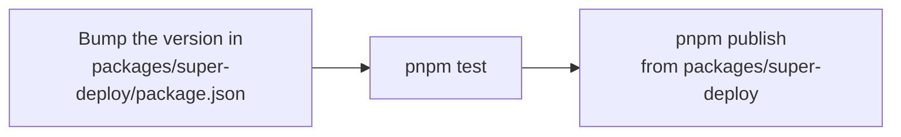

# Contributing

A pnpm workspace: Node 24, ESM only, and strict TypeScript built with `tsc`.

| Path | What it is |
| --- | --- |
| `packages/super-deploy` | The library and the `super-deploy` CLI. Its build bundles the template into `dist/template`. |
| `packages/template` | The project that `super-deploy init` copies. Its `README.md` is the user guide. |
| `examples/shop` | An example project with a real migration history. |

Open `super-deploy.code-workspace` in VS Code to get per-package settings.

## Development

```sh
pnpm install           # also installs the Git hooks and builds dist/
pnpm build             # rebuild dist/ after changing the library
pnpm lint              # Biome, every package
pnpm typecheck
pnpm test              # unit and integration tests
pnpm test:unit         # tests that need no database
pnpm test:integration  # tests against real PostgreSQL 18
```

Cross-package scripts run as `pnpm -r <script>`. The pre-commit hook runs `pnpm precommit`.

> [!NOTE]
> Error messages link to headings in `packages/template/README.md`, such as "Drift", "Permissions" and "Renaming a column". Keep those headings when editing the guide.

## Releasing



- `init` pins new projects to this version, and `finalize` records it in each migration's metadata.
- `test/integration/package.test.ts` checks that the tarball keeps every template file. `prepack` rebuilds `dist/`.

> [!CAUTION]
> You can unpublish a version only within 72 hours, and its number can never be reused. After publishing, any change to the history schema's columns must raise `historyLayoutVersion` (`deploy/history.ts`) and ship an upgrade step.
