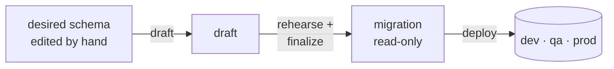

<p align="center"></p>

# super-deploy

Immutable, all-or-nothing **PostgreSQL 18** migrations, generated from the schema you declare.



```sh
pnpm dlx super-deploy init
```

| | |
| --- | --- |
| 📦 [**Package**](packages/super-deploy/README.md) | Install and quick start |
| 📖 [**Guide**](packages/template/README.md) | Full reference, copied into every project |
| 🛒 [**Example**](examples/shop/README.md) | A real migration history, walked through |
| 🛠️ [**Contributing**](CONTRIBUTING.md) | Developing and releasing super-deploy |

## Licence

[MIT](LICENSE)
