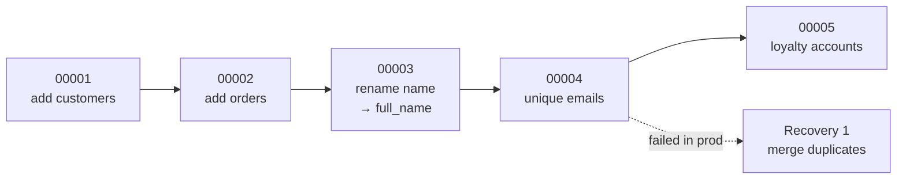
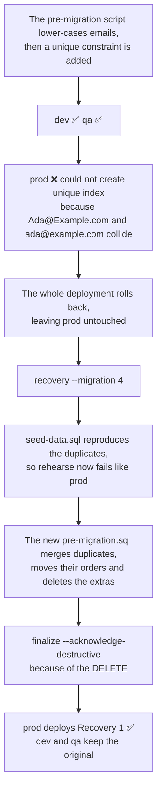
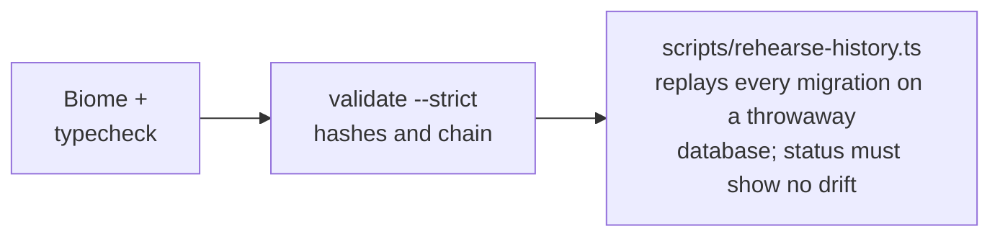

# Example: shop

A small shop database with five migrations, all made with the real CLI, so their hashes and generated SQL are genuine. Read them in order to see the workflow, including a deployment that failed on production data.

```sh
pnpm install                                  # from the repository root
pnpm precommit                                # what the Git hook and CI run
pnpm exec super-deploy deploy --target dev
pnpm exec super-deploy status --target dev
```

## The history



| Migration | Shows |
| --- | --- |
| [`00001-add-customers`](data-model/migrations/00001-add-customers) | The basic loop: edit, `draft`, `finalize`. |
| [`00002-add-orders`](data-model/migrations/00002-add-orders) | A foreign key, an index and named constraints. |
| [`00003-rename-customer-name-to-full-name`](data-model/migrations/00003-rename-customer-name-to-full-name) | A rename in a pre-migration script. |
| [`00004-unique-customer-emails`](data-model/migrations/00004-unique-customer-emails) | A data fix that failed in production, and the Recovery that fixed it. |
| [`00005-add-loyalty-accounts`](data-model/migrations/00005-add-loyalty-accounts) | A new table backfilled by a post-migration script. |

### 00002: unnamed constraints are refused

`draft` refused the first version of the file before doing any database work:

```
orders.sql:1: The foreign key constraint on orders.customer_id has no name; name it … [unnamed-constraint]
```

### 00003: a rename is a drop plus an add

`draft` can't tell a rename from a drop plus an add, so it warned that the column's data would be lost. The fix is `alter table … rename column` in `pre-migration.sql`, after which `draft` generates an empty schema change.

> [!NOTE]
> PostgreSQL 18 names `NOT NULL` constraints, such as `customers_name_not_null`, and a rename keeps the old name. Rename the constraint too, or `rehearse` reports a mismatch.

### 00004: failed in production, fixed by a Recovery



### 00005: backfill after the schema change

The schema change creates `loyalty_accounts`, and `post-migration.sql` fills it from the existing customers and orders. Seed data gives the rehearsals rows to backfill.

## How the history is checked

`pnpm precommit`, run by the Git hook and in CI:



For what each file in a migration folder is, see [the guide](../../packages/template/README.md#the-files-of-a-draft-and-a-migration).
