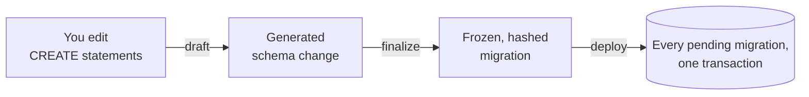

# super-deploy

Immutable, all-or-nothing **PostgreSQL 18** migrations, generated from the schema you declare.



- **Declarative:** describe the end state, and super-deploy writes the migration.
- **Rehearsed:** every migration is replayed on a throwaway database before it is frozen and before it is deployed.
- **All-or-nothing:** a failed deployment rolls back completely.
- **Immutable:** finalized migrations are hash-chained, and Git hooks and CI catch edits.

## Quick start

Requires Node 24 and pnpm. No database is needed, because projects run private embedded PostgreSQL servers.

```sh
mkdir my-schema && cd my-schema
pnpm dlx super-deploy init
git init && pnpm install
```

Write `CREATE` statements in `data-model/desired-schema/`, then run:

```sh
pnpm exec super-deploy draft --name "add customers"
pnpm exec super-deploy finalize
pnpm exec super-deploy deploy --target dev
```

Run `pnpm exec super-deploy` with no arguments for an interactive menu.

## Documentation

- **[The guide](https://github.com/larsenjd/super-deploy/blob/main/packages/template/README.md)**: every project gets a copy as its `README.md`.
- **[Example project](https://github.com/larsenjd/super-deploy/tree/main/examples/shop)**: a real migration history, including a failed deployment and its fix.

## Licence

MIT
